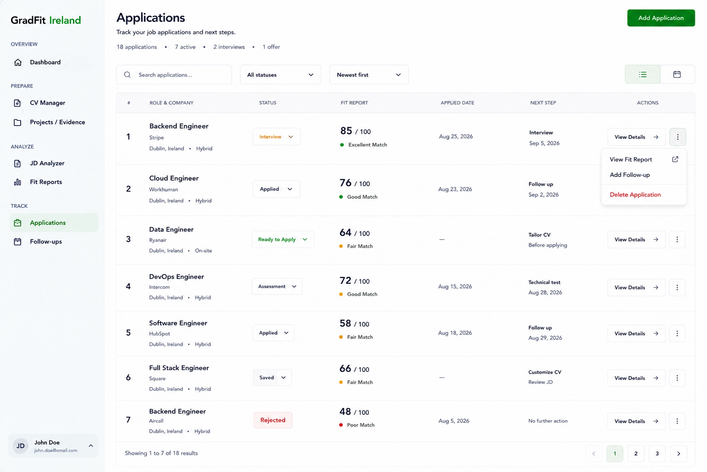
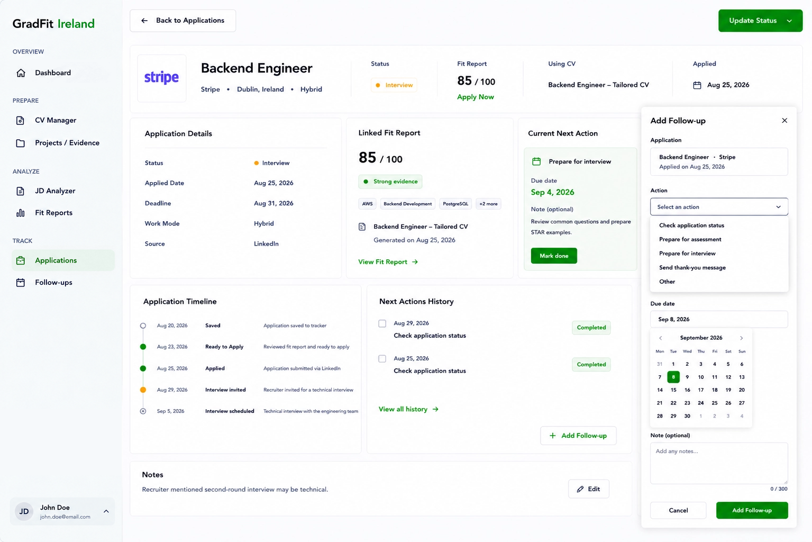

# Applications UI Design

Applications tracks saved jobs, application status, fit scores, and next actions.

## Applications list

The list page includes:

- Application summary counts.
- Search, status filtering, and sorting.
- List and calendar view controls.
- Role, company, status, fit report, applied date, next step, and actions.
- Pagination.
- Row actions for viewing the Fit Report, adding a follow-up, or deleting an application.
- Add Application primary action.

## Application detail

The detail page includes:

- Job and company header with status, fit score, selected CV, and applied date.
- Application Details card.
- Linked Fit Report card.
- Current Next Action panel with due date, notes, and completion action.
- Application Timeline.
- Next Actions History.
- Notes with edit action.
- Update Status control.

## Add Follow-up drawer

The Add Follow-up drawer is opened from an application detail page and includes:

- The related application.
- Action selection, such as checking application status, preparing for assessment, preparing for interview, sending a thank-you message, or another action.
- Due date picker.
- Optional note with a 300-character limit.
- Cancel and Add Follow-up actions.
