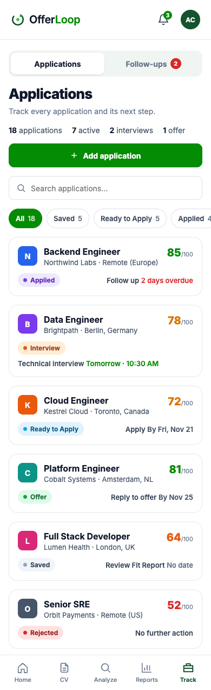
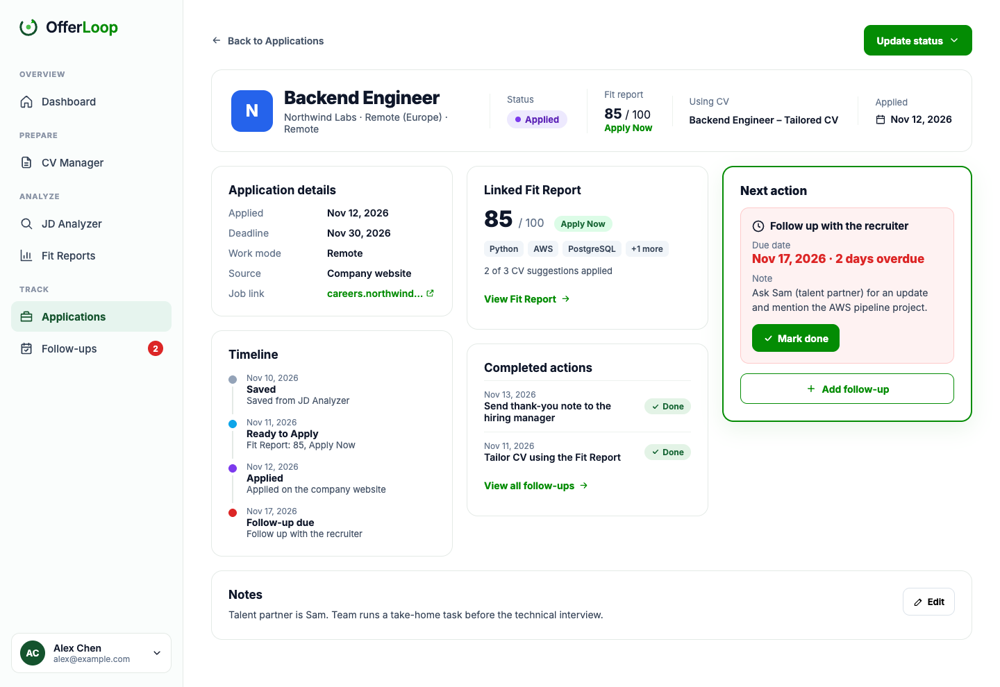
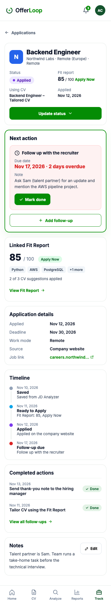
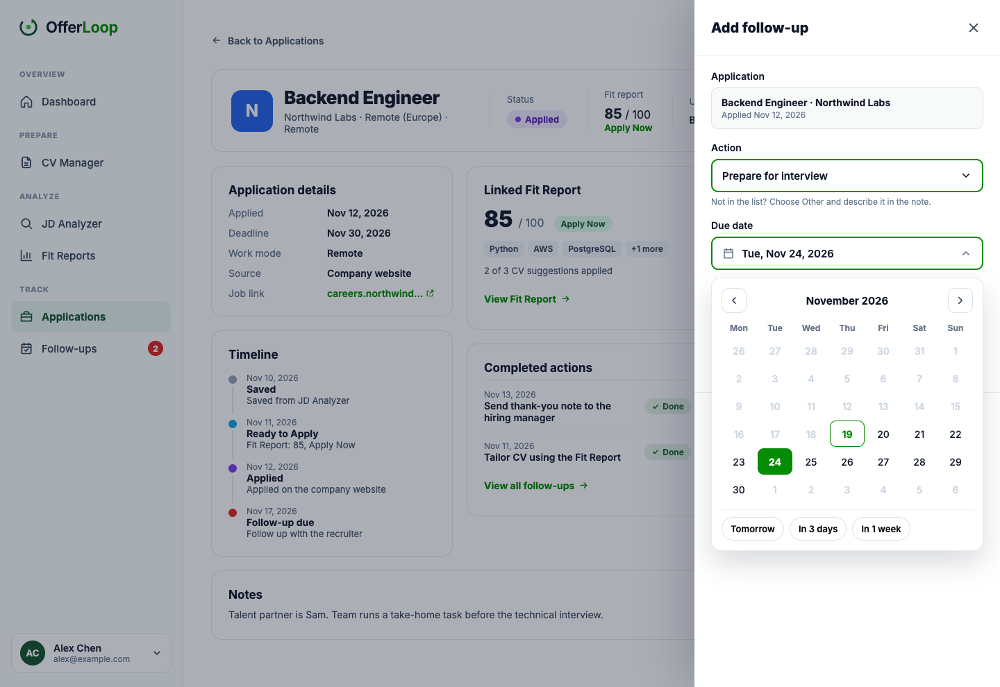

# Applications UI Design

Applications tracks every application, its status and its next step.

### Applications list

| Desktop | Mobile |
| --- | --- |
|  |  |

- Summary counts and status filter chips: All, Saved, Ready to Apply, Applied, Interview, Offer, Rejected.
- Search and sorting by next step due.
- Role and company, status, Fit Report score, applied date, next step (overdue in red), Details and a more-actions menu.
- On mobile, the Track tab switches between Applications and Follow-ups.

### Application detail

| Desktop | Mobile |
| --- | --- |
|  |  |

- Header with status, Fit Report score, CV used, applied date and an Update status menu.
- Next action (highlighted): the current follow-up, Mark done and Add follow-up.
- Application details, linked Fit Report, timeline, completed actions and notes.

## Add follow-up

| Form | Calendar open |
| --- | --- |
|  |  |

- Related application.
- Action dropdown: check application status, follow up with recruiter, prepare for interview, prepare for assessment, send thank-you message, or Other. With Other, the note describes the action and becomes required.
- Due date with a month calendar and quick picks: Tomorrow, In 3 days, In 1 week.
- Optional note, up to 300 characters.
