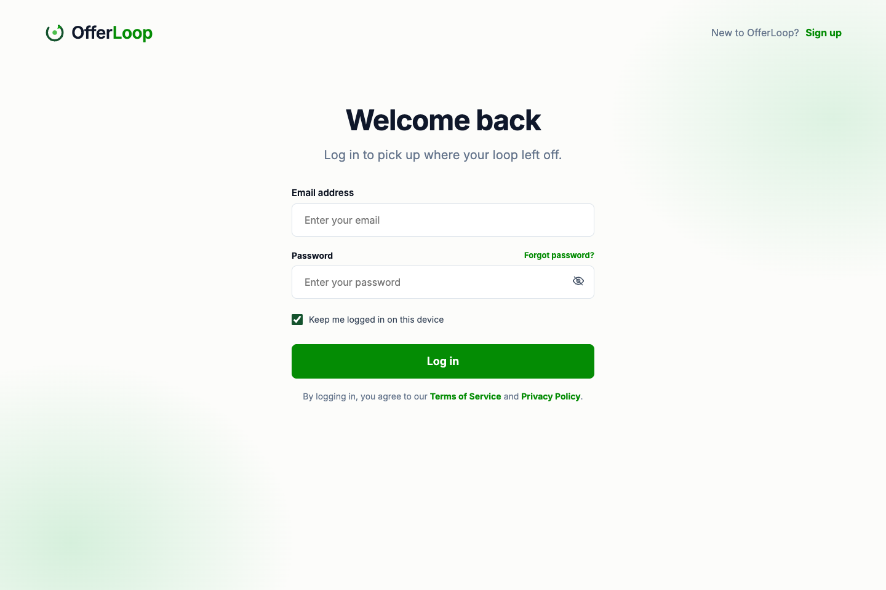
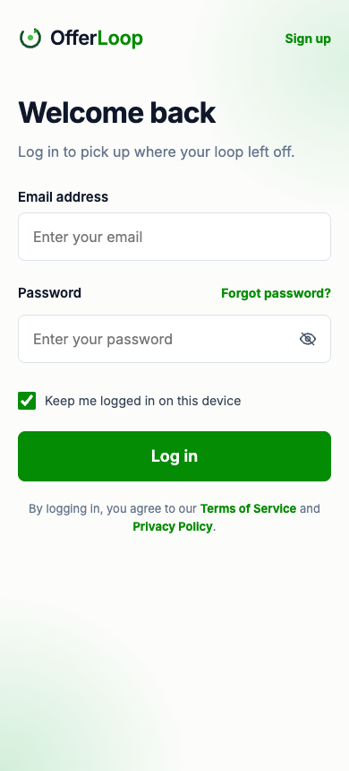
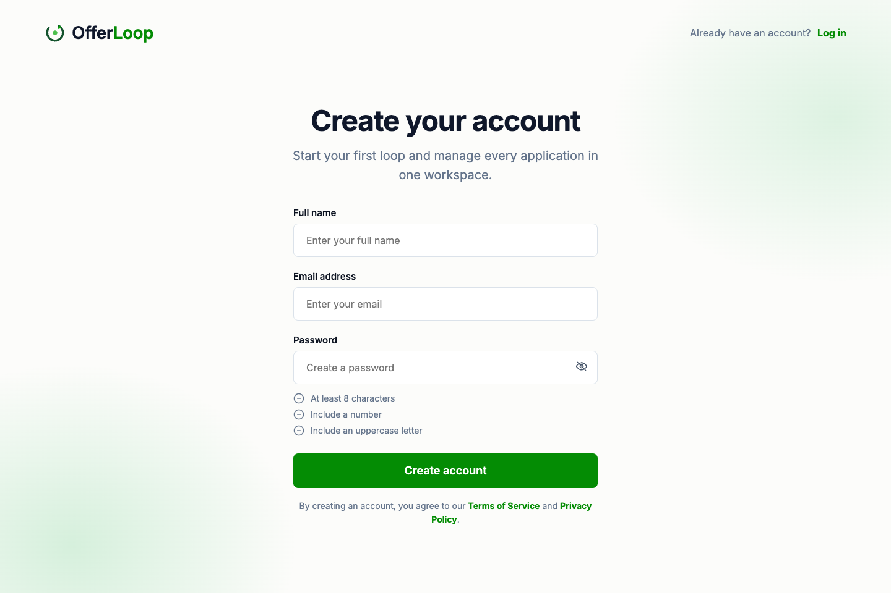
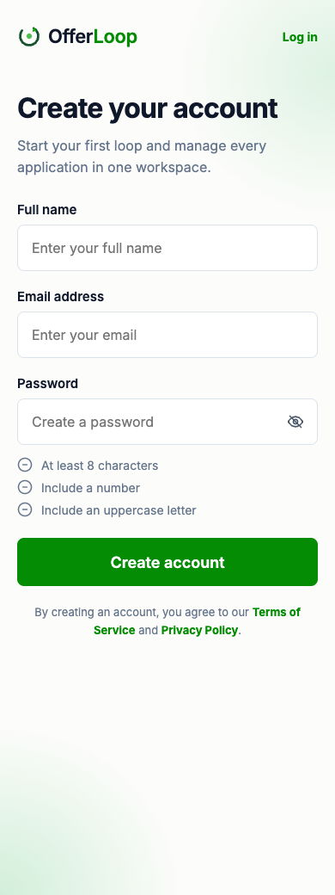
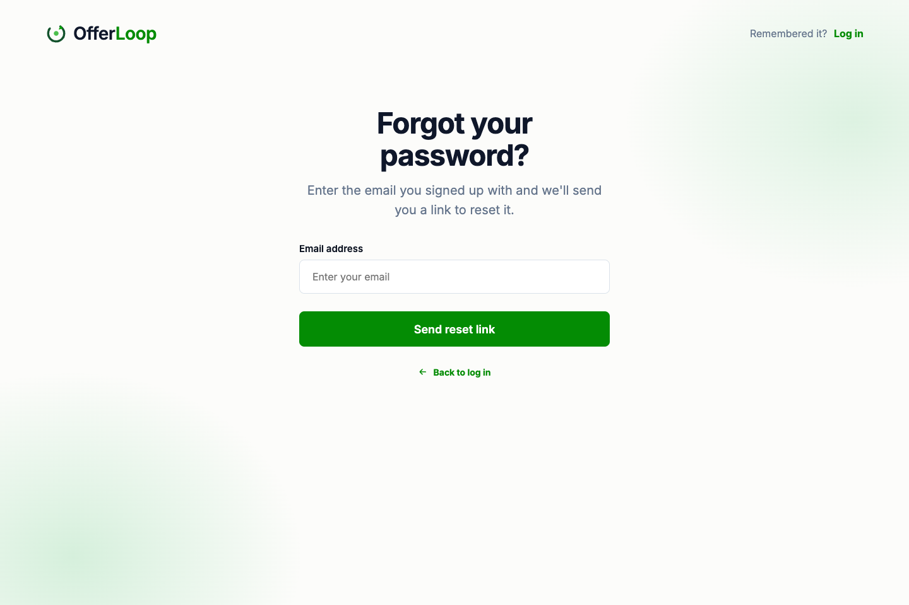
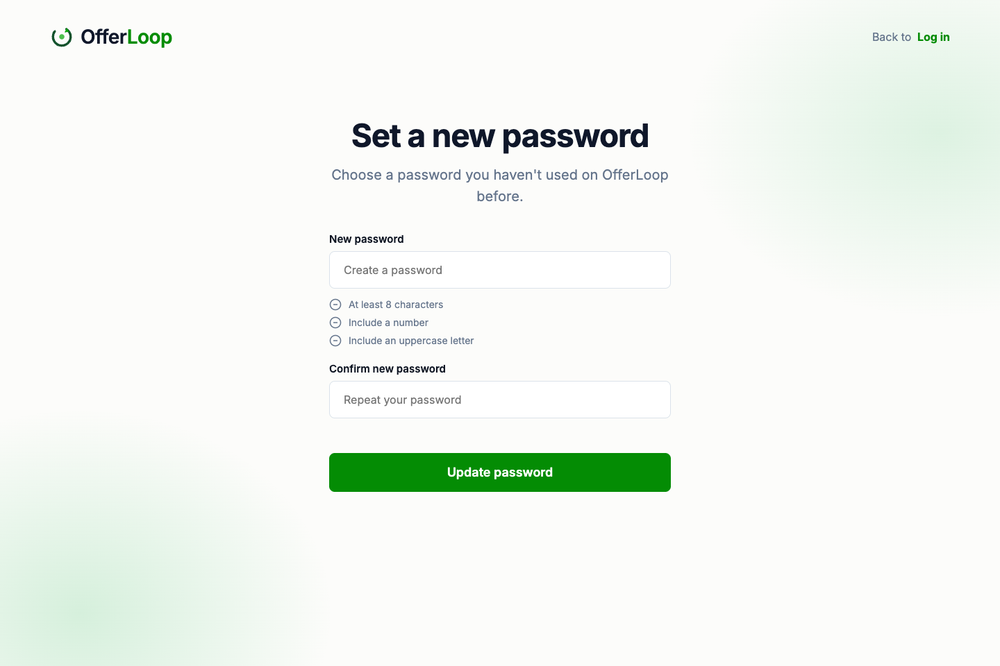
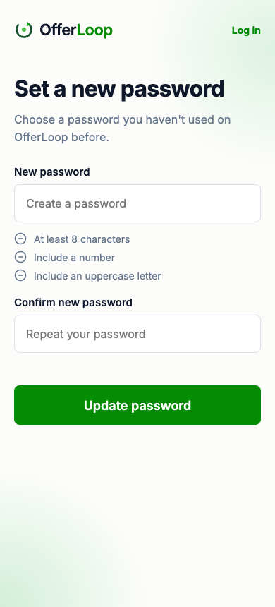

# Account UI Design

Account pages share one centered layout: logo top left, a link to the other flow top right, a large title, labeled inputs and one green primary button.

### Log in

| Desktop | Mobile |
| --- | --- |
|  |  |

### Sign up

| Desktop | Mobile |
| --- | --- |
|  |  |

### Forgot password

| Desktop | Mobile |
| --- | --- |
|  |  |

### Reset password

| Desktop | Mobile |
| --- | --- |
|  |  |

## Notes

- Sign up and Reset password check password rules live: at least 8 characters, a number and an uppercase letter.
- Forgot password switches to a "Check your email" state after sending the link.
- No social login.
