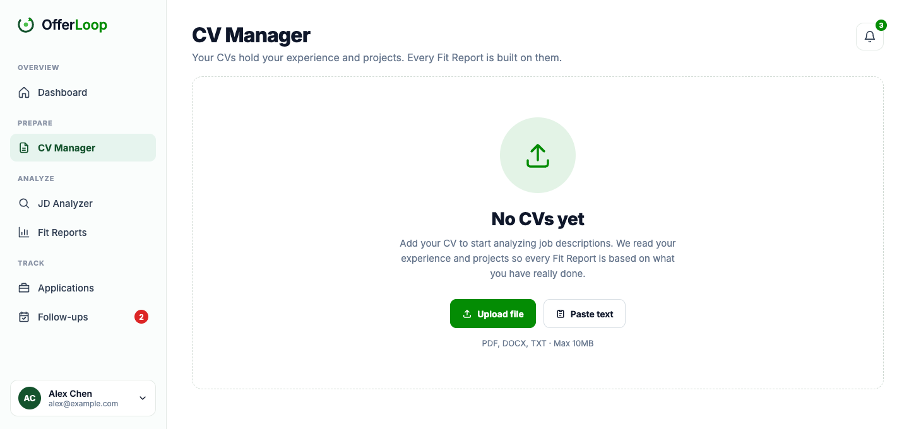
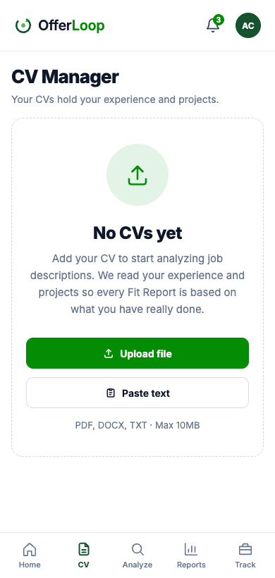
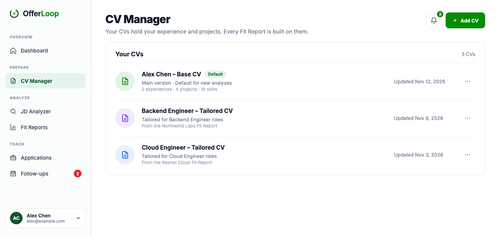
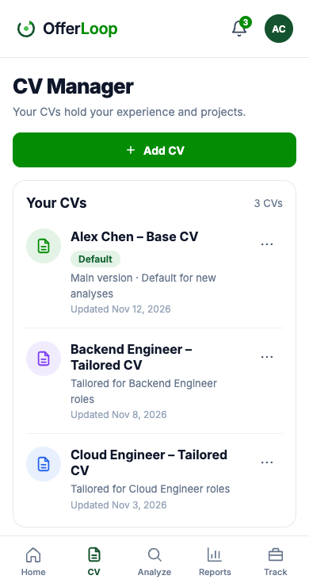

# CV Manager UI Design

Projects and experience are part of the CV, so there is no separate Projects / Evidence module.

### No CV yet

| Desktop | Mobile |
| --- | --- |
|  |  |

The empty state lets the user upload a CV file (PDF, DOCX, TXT, up to 10MB) or paste CV text.

### Your CVs

| Desktop | Mobile |
| --- | --- |
|  |  |

The list shows the Base CV (default for new analyses) and tailored versions, with a short description, last-updated date and a more-actions menu. There is no CV detail page.
