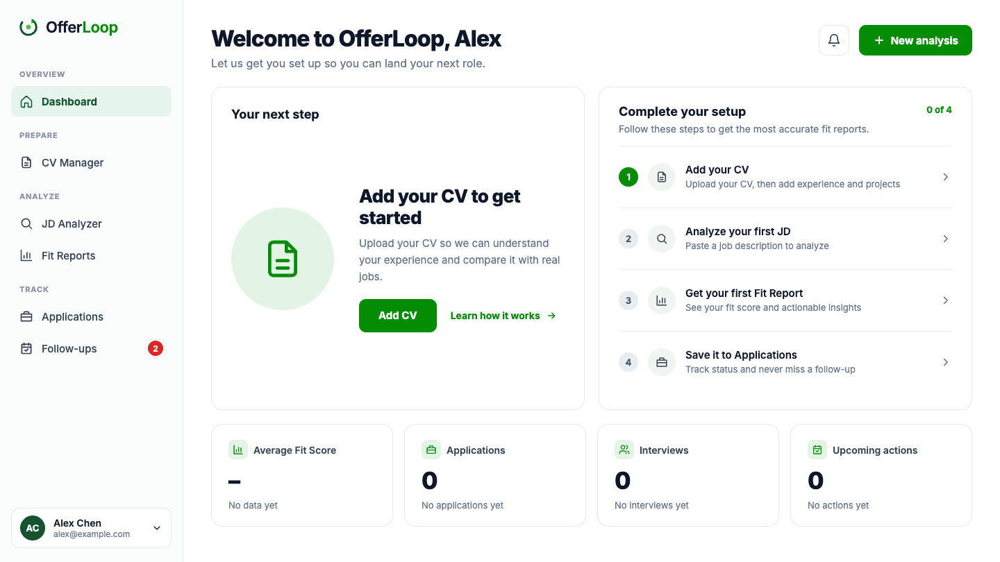
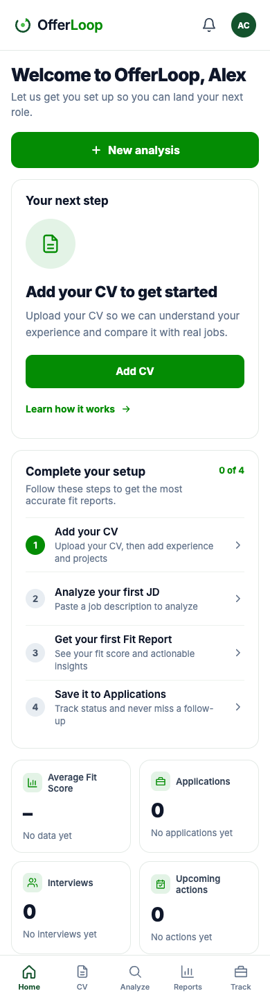
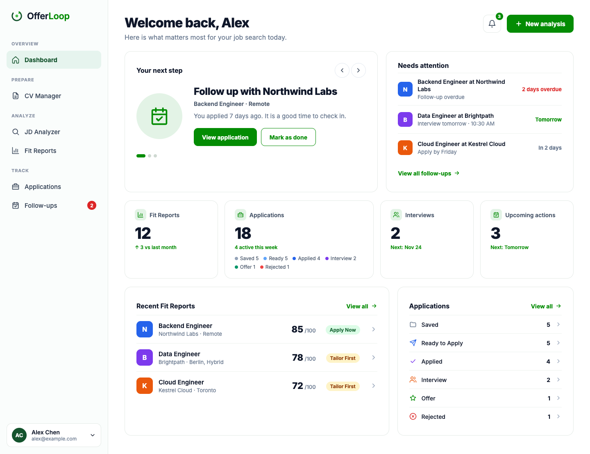
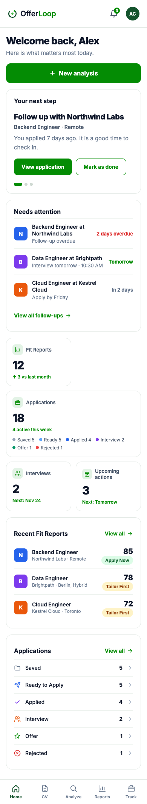

# Dashboard UI Design

Dashboard has two states, based on whether the user has data yet. Desktop uses the sidebar shell; mobile uses a top bar and a bottom tab bar (Home, CV, Analyze, Reports, Track).

### New user

| Desktop | Mobile |
| --- | --- |
|  |  |

The new-user dashboard shows:

- Your next step: add your CV.
- Complete your setup: add your CV (with experience and projects), analyze your first JD, get your first Fit Report, save it to Applications.
- Empty summary cards.

### Existing user

| Desktop | Mobile |
| --- | --- |
|  |  |

The existing-user dashboard shows:

- Your next step, with previous and next controls and Mark as done.
- Needs attention: overdue and upcoming follow-ups.
- Summary cards. The Applications card breaks down counts by status.
- Recent Fit Reports and applications by status.

## Shared layout

- Sidebar navigation grouped as Overview, Prepare, Analyze and Track, with a very light green background.
- Follow-ups shows a red badge with the number of overdue follow-ups.
- Notification action, New analysis action and user profile area.
