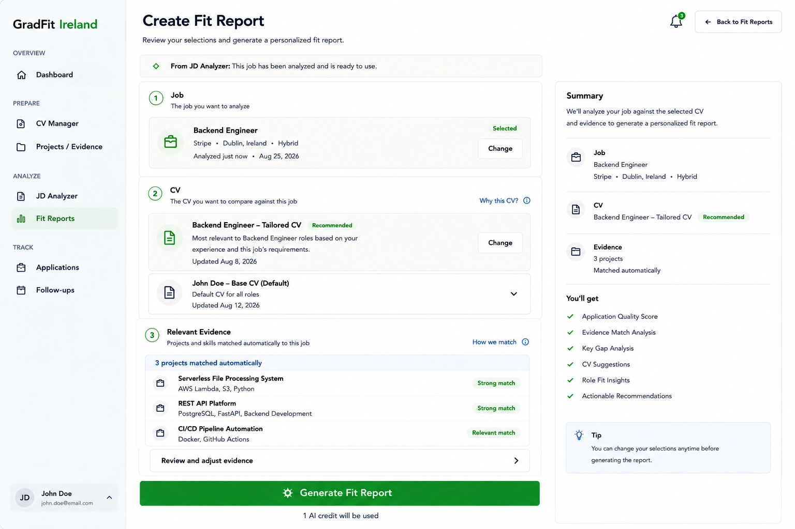
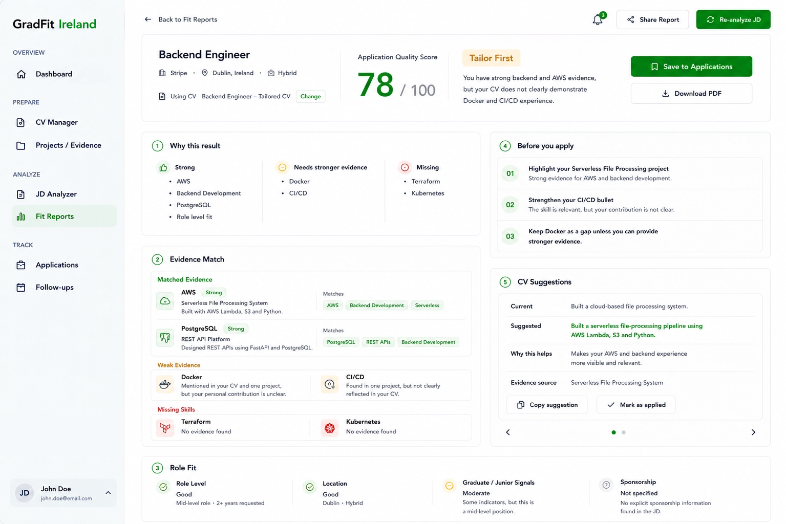
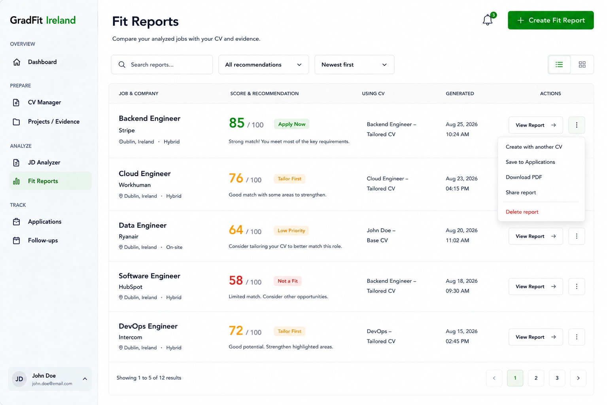

# Fit Reports UI Design

Fit Reports compares analyzed jobs with the user's CV and project evidence, then gives an application recommendation.

## Create Fit Report

The creation flow lets the user review:

- The selected analyzed job.
- The CV to compare against the job.
- Automatically matched project evidence.
- A summary of the report contents.
- The AI credit that will be used.

The user can change the job, CV, or evidence before selecting Generate Fit Report.

## Fit Report result

The result page includes:

- Application Quality Score and recommendation.
- Why this result: strong, needs stronger evidence, and missing skills.
- Evidence Match grouped by matched, weak, and missing evidence.
- Role Fit for level, location, graduate / junior signals, and sponsorship.
- Before-you-apply actions.
- Evidence-based CV suggestions.
- Actions to save to Applications, download PDF, share, or re-analyze.

## Fit Reports list

The list page includes:

- Search and recommendation filters.
- Newest-first sorting.
- List and grid view controls.
- Job, company, score, recommendation, CV, generated date, and actions.
- Pagination and report actions such as create with another CV, save to Applications, download, share, and delete.
