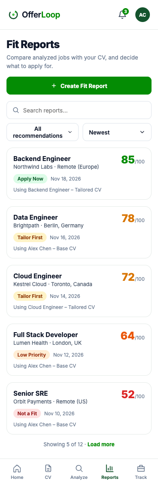
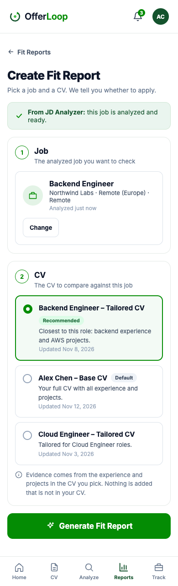
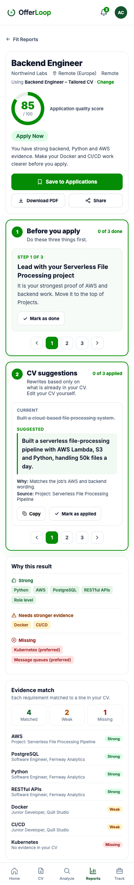

# Fit Reports UI Design

A Fit Report compares an analyzed job with one of the user's CVs. Its focus is what to do before applying and how to improve the CV.

### Fit Reports list

| Desktop | Mobile |
| --- | --- |
|  |  |

- Search, recommendation filter and sorting.
- Job and company, score and recommendation, CV used, generated date.
- View report and a menu: create with another CV, save to Applications, download PDF, share, delete.

### Create Fit Report

| Desktop | Mobile |
| --- | --- |
|  |  |

- Step 1: the analyzed job.
- Step 2: the CV to compare. The closest CV is marked Recommended.
- Evidence comes only from the selected CV.

### Fit Report result

| Desktop | Mobile |
| --- | --- |
|  |  |

- Header: score, recommendation, summary, Save to Applications and Download PDF.
- **1 Before you apply** (highlighted): one step at a time with numbered and arrow paging, and Mark as done.
- **2 CV suggestions** (highlighted): one suggestion at a time with numbered and arrow paging. Each shows current text, suggested text, why it helps and the source in the CV, with Copy and Mark as applied. Users edit their CV themselves.
- Why this result: strong, needs stronger evidence, missing.
- Evidence match: counts plus every requirement and the CV line that supports it.
- No separate Role fit section.
