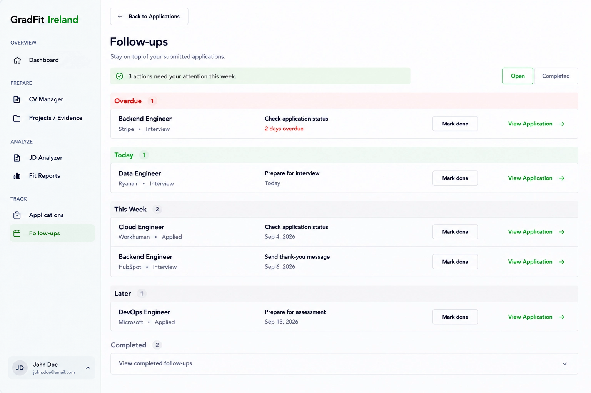

# Follow-ups UI Design

Follow-ups helps users stay on top of actions related to submitted applications.

The page includes:

- Back to Applications navigation.
- Open and Completed tabs.
- Weekly attention summary.
- Follow-ups grouped into Overdue, Today, This Week, Later, and Completed.
- Related role, company, and application status.
- Follow-up action and due date.
- Mark done action.
- View Application link.
- Expandable completed follow-ups section.
