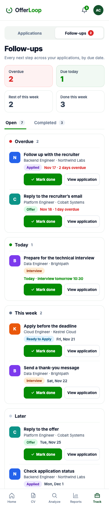

# Follow-ups UI Design

### Follow-ups

| Desktop | Mobile |
| --- | --- |
|  |  |

Follow-ups shows every next step across all applications, by due date. Follow-ups are added and edited from an application; this page is for reviewing and completing them.

- Desktop: its own sidebar item with a red badge for overdue items. Mobile: a switch inside the Track tab.
- Summary: overdue, due today, rest of this week, done this week.
- Open and Completed tabs.
- Groups: Overdue, Today, This week, Later.
- Each item: action, role and company, application status, due date, Mark done and View application.
