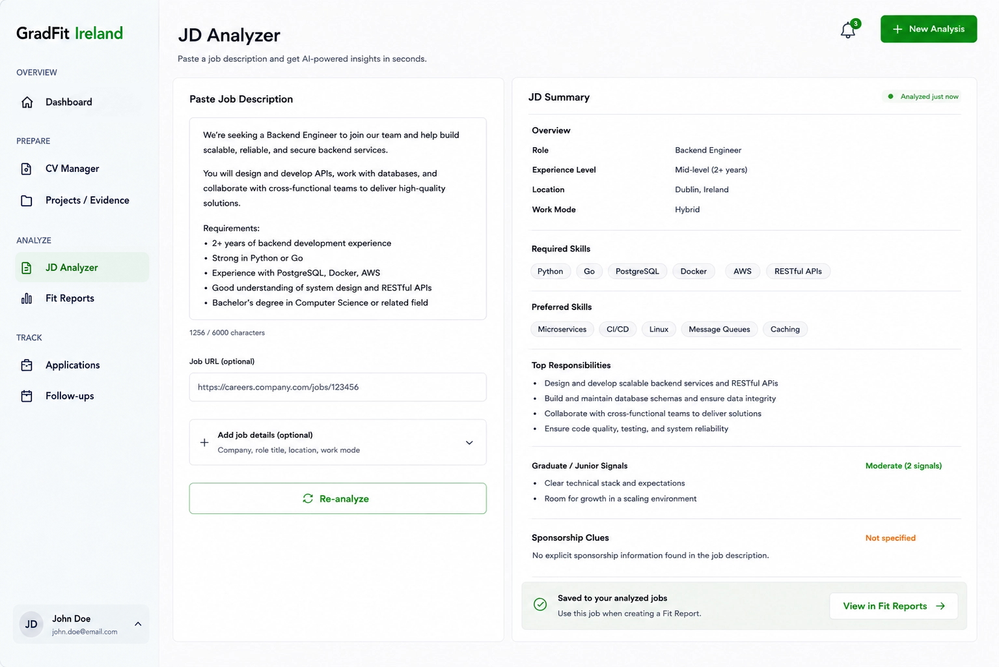

# JD Analyzer UI Design

JD Analyzer lets users paste a job description and receive AI-powered insights.

## Empty state

The empty state includes:

- Job description text area with a 6,000-character limit.
- Optional job URL.
- Optional expandable job details: company, role title, location, and work mode.
- Analyze JD action.
- Empty JD Summary panel explaining the analysis capabilities.

## Analyzed state

The analyzed state displays:

- The pasted job description and re-analyze action.
- Role overview, experience level, location, and work mode.
- Required skills and preferred skills.
- Top responsibilities.
- Graduate / junior signals.
- Sponsorship clues.
- Save status and a link to Fit Reports.
