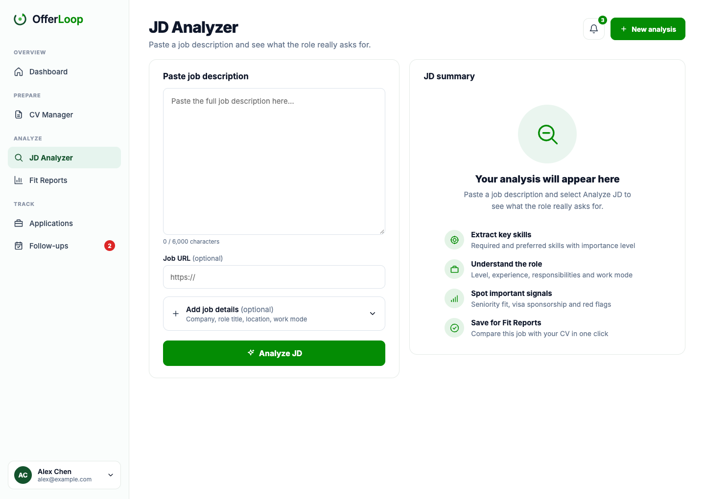
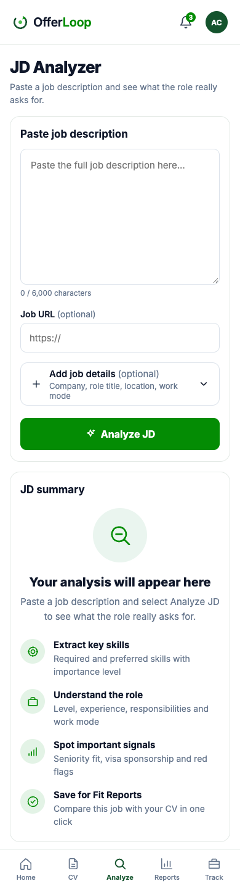
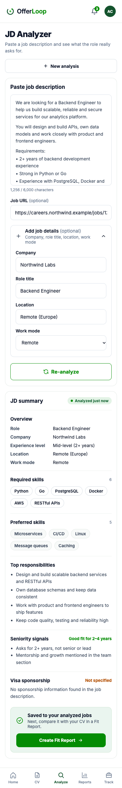

# JD Analyzer UI Design

JD Analyzer lets users paste a job description and see what the role really asks for.

### Before analysis

| Desktop | Mobile |
| --- | --- |
|  |  |

- Job description text area with a 6,000-character limit.
- Optional job URL.
- Optional job details: company, role title, location and work mode.
- Analyze JD action.

### Analyzed

| Desktop | Mobile |
| --- | --- |
|  |  |

- Overview: role, company, experience level, location, work mode.
- Required and preferred skills.
- Top responsibilities.
- Seniority signals and visa sponsorship.
- Saved to analyzed jobs, with a Create Fit Report action.
