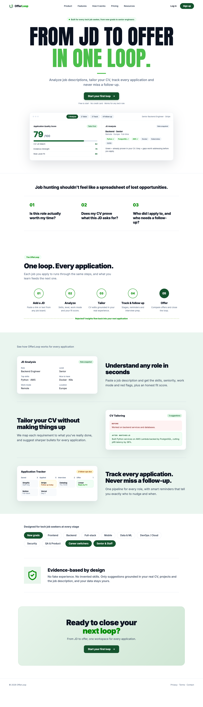

# Main Page UI Design

### Main page

| Desktop | Mobile |
| --- | --- |
|  |  |

## Page purpose

The Main Page introduces OfferLoop to tech job seekers at every stage and explains the loop from job description to offer.

Slogan: **From JD to Offer in one loop.** Analyze job descriptions, tailor your CV, track every application and never miss a follow-up.

## Main sections

1. Header navigation with Log in and Sign up.
2. Hero with the slogan, the "Start your first loop" action and a product card with tabs: Analyze, Tailor, Track, Follow up.
3. Three questions the product answers.
4. The OfferLoop: Add a JD, Analyze, Tailor, Track and follow up, Offer.
5. Feature blocks: JD analysis, evidence-based CV tailoring, application tracking.
6. Who it is for: role and career-stage chips.
7. Evidence-based by design.
8. Final call to action and footer.
