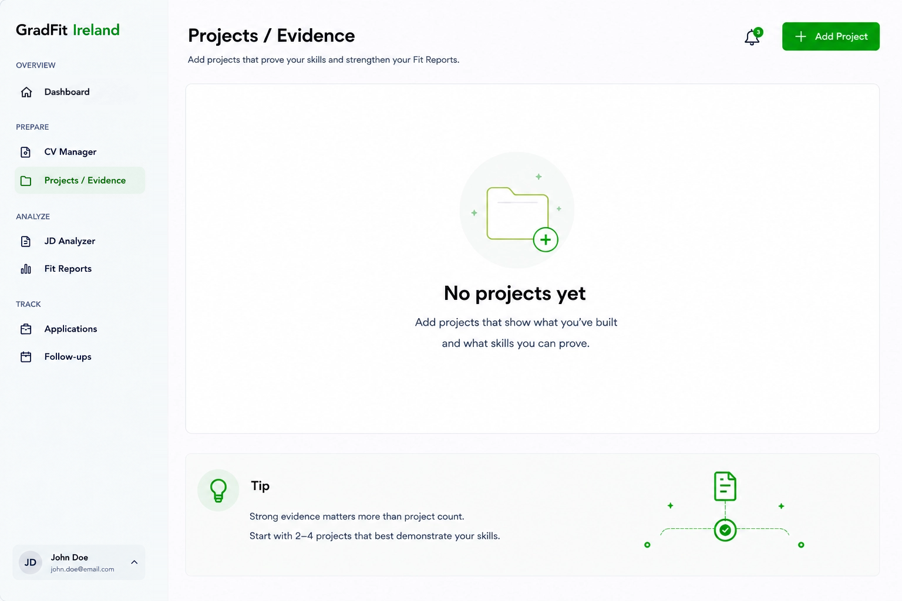
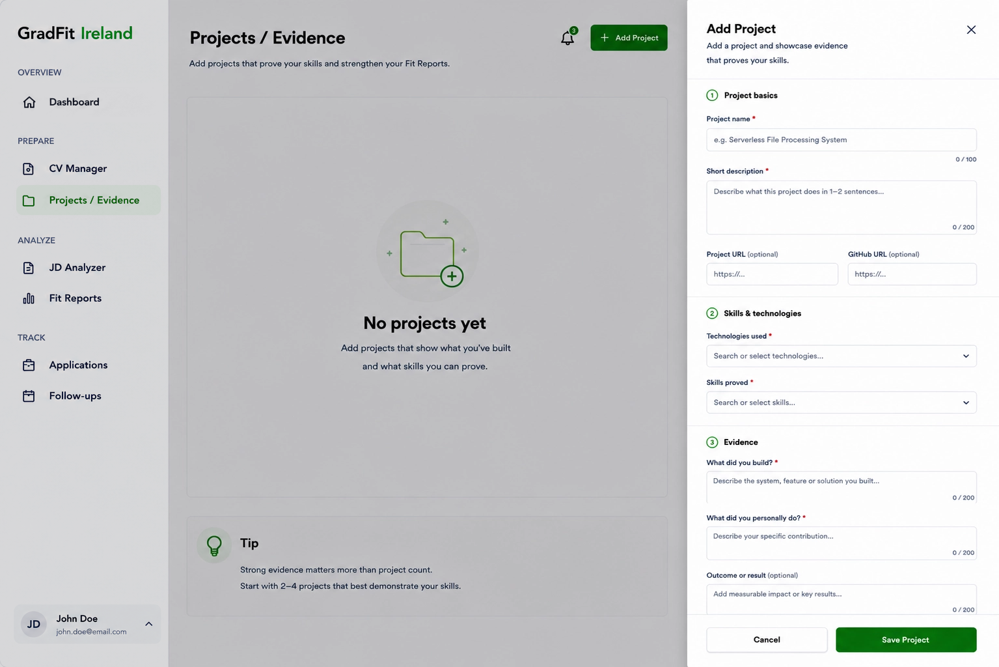
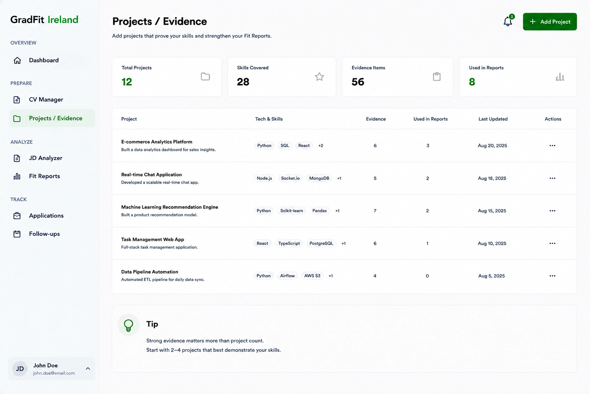

# Projects / Evidence UI Design

Projects / Evidence helps users record projects that prove their technical skills and strengthen Fit Reports.

## Empty state

The empty state includes:

- Projects / Evidence heading and description.
- Add Project primary action.
- No projects message.
- Tip explaining that strong evidence matters more than project count.
- Shared application navigation with Projects / Evidence active.

## Add project drawer

The Add Project drawer collects three groups of information:

1. Project basics: project name, short description, project URL, and GitHub URL.
2. Skills and technologies: technologies used and skills proved.
3. Evidence: what was built, personal contribution, and optional outcome or result.

The drawer provides Cancel and Save Project actions.

## Existing user state

The existing state includes:

- Summary cards for total projects, skills covered, evidence items, and reports using projects.
- A project table with technologies, skills, evidence count, report usage, last updated date, and actions.
- Tip content at the bottom.
